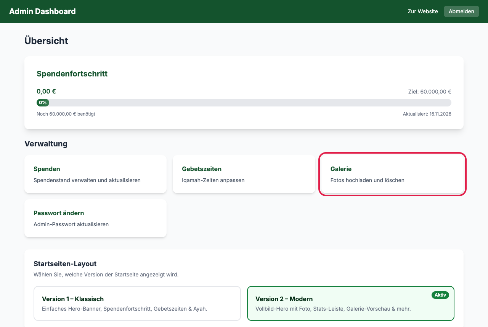
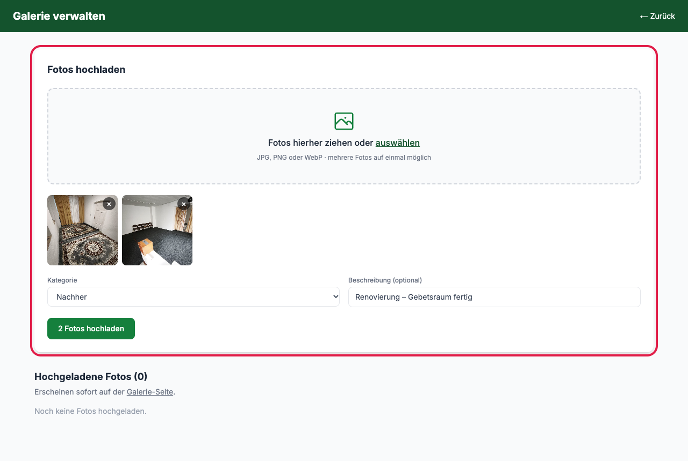
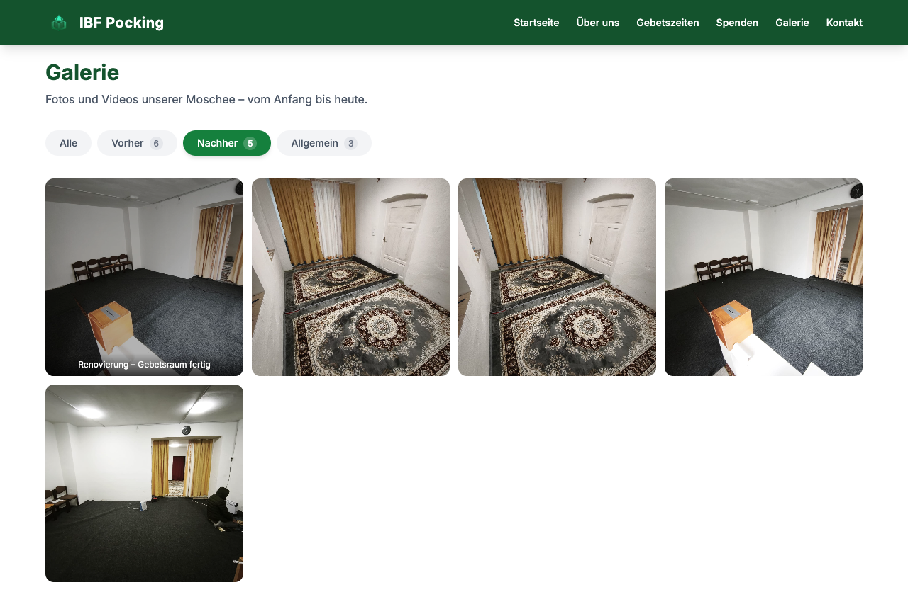

# Fotos zur Galerie hinzufügen

So kommen neue Fotos auf die Galerie-Seite der Website. Dauer: etwa 1 Minute.

## 1. Admin-Bereich öffnen

Gehen Sie auf **/admin** und melden Sie sich an. Klicken Sie auf **Galerie**.

## 2. Fotos auswählen und hochladen

1. Ziehen Sie die Fotos in das gestrichelte Feld – oder klicken Sie auf **auswählen**. Mehrere Fotos auf einmal gehen.
2. Sie sehen eine Vorschau. Mit **×** entfernen Sie ein Foto wieder.
3. Wählen Sie eine **Kategorie** (z. B. „Nachher“ oder „Veranstaltungen“).
4. Optional: eine kurze **Beschreibung**. Sie gilt für alle gewählten Fotos.
5. Klicken Sie auf **Fotos hochladen**.

Große Handy-Fotos werden automatisch verkleinert. Sie müssen nichts vorbereiten.

## 3. Fertig – Fotos sind sofort online

Die Fotos erscheinen sofort auf der Galerie-Seite, ganz vorne. Besucher können sie anklicken und groß ansehen.

## Foto löschen

Im Admin-Bereich unter **Galerie** steht unter jedem Foto **Löschen**. Klicken und bestätigen.

## Gut zu wissen

- Erlaubt sind Fotos (JPG, PNG, WebP). **Videos** gehen hier nicht.
- Bitte nur Fotos hochladen, mit denen die gezeigten Personen einverstanden sind.
